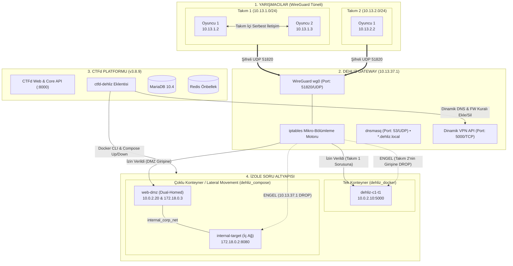
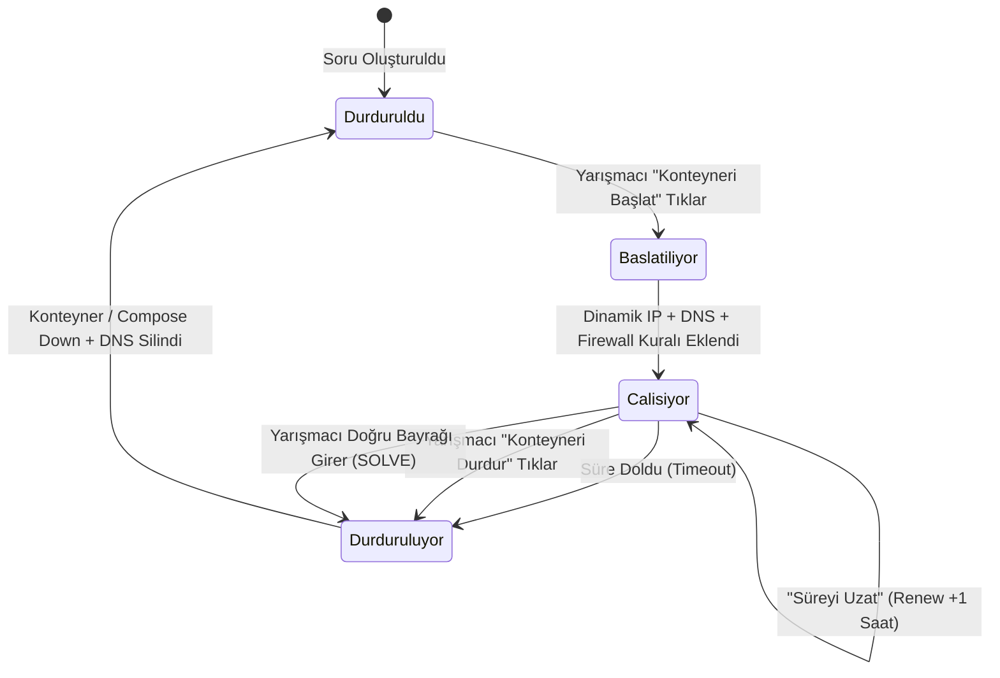

# 🛡️ Dehliz CTF — Kapsamlı Sistem, Mimari ve Geliştirici Dökümantasyonu

> **Sürüm:** 2.0 (Native Dehliz Orchestrator + Docker Compose + CTFd v3.8.9)  
> **Tarih:** Ekim 2026  
> **Lisans:** MIT  

---

## 📑 İçindekiler
1. [Giriş ve Felsefe](#1-giriş-ve-felsefe)
2. [Sistem ve Ağ Mimarisi](#2-sistem-ve-ağ-mimarisi)
3. [Mikro-Bölümleme & Güvenlik Matrisi](#3-mikro-bölümleme--güvenlik-matrisi)
4. [Yerel Orkestrasyon Motoru (Native Dehliz)](#4-yerel-orkestrasyon-motoru-native-dehliz)
5. [Konteyner Yaşam Döngüsü (Lifecycle Management)](#5-konteyner-yaşam-döngüsü-lifecycle-management)
6. [Soru Geliştirme Rehberi (Challenge Creator Guide)](#6-soru-geliştirme-rehberi-challenge-creator-guide)
7. [Yarışmacı Rehberi & Bağlantı Kurulumu](#7-yarışmacı-rehberi--bağlantı-kurulumu)
8. [Uçtan Uca Lateral Movement Labı (Walkthrough)](#8-uçtan-uca-lateral-movement-labı-walkthrough)
9. [Otomatik Test Paketi (Cyber Range QA - 35 Test)](#9-otomatik-test-paketi-cyber-range-qa---35-test)
10. [Yönetim, Bakım ve Dağıtım Rehberi (DevOps)](#10-yönetim-bakım-ve-dağıtım-rehberi-devops)

---

## 1. Giriş ve Felsefe

### 1.1. Dehliz CTF Nedir?
**Dehliz CTF**, standart CTFd platformunu tek bir hamlede **Hack The Box** ve kurumsal **Cyber Range (Siber Tatbikat Sahası)** kalitesinde izole, şifreli tünelli ve multi-tenant bir siber tatbikat ortamına dönüştüren açık kaynaklı bir altyapı motorudur.

Klasik CTF organizasyonlarında sıkça kullanılan harici port yönlendirme (FRP/Reverse Proxy) yaklaşımı; gerçek hayat senaryolarından uzaktır, takım izolasyonunu sağlayamaz, yarışmacıların birbirine saldırmasını engelleyemez ve ters bağlantı (reverse shell) açılmasını neredeyse imkansız kılar. 

Dehliz CTF, **Sıfır Dış Port (Zero Public Port)** ilkesiyle çalışır:
* Soru konteynerleri internete asla port açmaz.
* Yarışmacılar platforma kriptografik **WireGuard VPN** tüneliyle bağlanır.
* Her takıma özel alt ağ (`10.13.<team_id>.0/24`) tahsis edilir.
* Takım arkadaşları birbirleriyle iletişim kurabilir, ters kabuk alabilir, ancak diğer takımların veya başka takımlara ait soruların trafiğini dinleyemez ve erişemez.
* **Split-Horizon DNS** ile her canlı soruya özel alan adı (`http://soru-adi-t1.dehliz.local`) otomatik oluşturulur.

### 1.2. Mimari Karşılaştırma: Geleneksel FRP vs. Dehliz CTF

| Kriter | Geleneksel CTFd + FRP Modeli | 🛡️ Dehliz CTF Modeli |
| :--- | :--- | :--- |
| **Dış Port Güvenliği** | Her soru için rastgele yüksek portlar (`31245` vb.) dış dünyaya açılır. | **0 Dış Port!** Tüm soru konteynerleri izole iç ağdadır. |
| **Bağlantı Protokolü** | Ham TCP bağlantısı (Şifresiz / Kolay Dinlenebilir) | **WireGuard Tüneli (Modern Kriptografi: Curve25519 & ChaCha20)** |
| **Ad Çözümleme (DNS)** | Yok. Yarışmacıya ezberlemesi zor IP ve port verilir. | **Otomatik Yerel DNS:** `http://soru-adi-t1.dehliz.local:5000` |
| **Ters Bağlantı (Reverse Shell)** | İmkansız / Çok Zor (Modem arkasındaki yarışmacı port açamaz). | **Doğal Destek:** `nc -lvnp 4444` açılır, konteynerden `10.13.1.2:4444`'e bağlanılır. |
| **Ağ Taraması (Port Scan / Nmap)** | İmkansız (Sadece harici tek porta bakılabilir). | **Tam Nmap Desteği:** `nmap soru-adi-t1.dehliz.local` ile tüm portlar taranabilir. |
| **Takım İzolasyonu** | Yok. Yarışmacılar diğer takımların oturumlarını bozabilir. | **Çekirdek Düzeyinde iptables Filtreleme (DROP).** |
| **Çoklu Konteyner (Pivoting / Lateral)** | Desteklenmez (Sadece tek konteyner portu açılabilir). | **Docker Compose Desteği:** DMZ + İzole Kurumsal İç Ağ senaryoları. |
| **Kaynak Tüketimi** | Ağır Java/Go reverse proxy servisleri. | **Ultra Hafif:** Alpine Linux tabanlı Gateway (~50 MB RAM). |

---

## 2. Sistem ve Ağ Mimarisi

Dehliz CTF, mikroservis mimarisine sahip 4 ana yapıtaşından oluşur:



### 2.1. Ağ Adresleme Planı (IPAM Schema)

| Ağ Segmenti | Alt Ağ (CIDR) | Açıklama |
| :--- | :--- | :--- |
| **Gateway Arayüzü** | `10.13.37.1/16` | WireGuard tünel sonlandırma ve DNS sunucusu |
| **Takım Tünelleri** | `10.13.<team_id>.0/24` | Her takıma dinamik ayrılan 254 IP'lik yarışmacı havuzu |
| **Soru Konteynerleri** | `10.0.2.0/24` (`dehliz_containers`) | Dışarıdan erişilebilen izole köprü ağı |
| **Dahili Lab Ağları** | `172.18.0.0/16` (`internal_net`) | Yalnızca lateral movement lablarına özel, dışa kapalı ağ |

---

## 3. Mikro-Bölümleme & Güvenlik Matrisi

Siber poligonun en kritik parçası **çekirdek düzeyinde paket filtreleme (Linux Netfilter / iptables)** mimarisidir.

### 3.1. İletişim Matrisi

| Kaynak | Hedef | Durum | Gerekçe / Kural |
| :--- | :--- | :--- | :--- |
| **Takım 1 Oyuncusu** | **Gateway DNS (`10.13.37.1:53`)** | ✅ **İZİN VERİLDİ** | Ad çözümleme için zorunlu |
| **Takım 1 Oyuncusu A** | **Takım 1 Oyuncusu B** | ✅ **İZİN VERİLDİ** | Takım içi yardımlaşma ve reverse shell |
| **Takım 1 Oyuncusu** | **Takım 1'in Soru Konteyneri** | ✅ **İZİN VERİLDİ** | Yarışmacının aktif lab ortamı |
| **Takım 1 Oyuncusu** | **Takım 2 Oyuncusu** | ❌ **ENGEL (DROP)** | Takımlar arası saldırı engelleme |
| **Takım 1 Oyuncusu** | **Takım 2'nin Soru Konteyneri**| ❌ **ENGEL (DROP)** | Başka takımın labına müdahale engelleme |
| **Takım 1 Oyuncusu** | **İç Hedef (`internal-target:8080`)**| ❌ **ENGEL (DROP)** | Pivoting zorunluluğu (Doğrudan erişim yasak) |
| **Soru Konteyneri** | **İnternet / Dış Dünya** | ❌ **ENGEL (DROP)** | Konteynerden dışarı veri kaçırma (exfiltration) engeli |

### 3.2. Dinamik Güvenlik Duvarı Kuralları (`gateway/vpn_manager.py`)
Bir takım soru başlattığında Gateway API'sine istek gönderilir ve çekirdeğe tek satırlık dinamik kural eklenir:
```bash
# Soru Başlatıldığında (Allow):
iptables -I FORWARD 1 -i wg0 -s 10.13.<team_id>.0/24 -d <container_ip> -j ACCEPT

# Soru Kapandığında / Çözüldüğünde (Cleanup):
iptables -D FORWARD -i wg0 -s 10.13.<team_id>.0/24 -d <container_ip> -j ACCEPT
```
Varsayılan kural `FORWARD DROP` olduğu için kural silindiği anda paketler anında düşer.

---

## 4. Yerel Orkestrasyon Motoru (Native Dehliz)

Dehliz CTF, harici ve bakımı zor Docker Whale eklentilerini tamamen ortadan kaldırarak **yerel Python orkestratörüne** geçmiştir.

### 4.1. Tek Konteyner Yöneticisi (`docker_manager.py`)
* `dehliz_docker` soru tipini yönetir.
* Docker Python SDK (`docker.from_env()`) üzerinden çalışır.
* Konteyneri `dehliz_containers` ağına bağlar, dinamik IP tahsis eder.
* `FLAG=DEHLIZ{<uuid4>}` ortam değişkenini otomatik enjekte eder.

### 4.2. Çoklu Konteyner Yöneticisi (`compose_manager.py`)
* `dehliz_compose` soru tipini yönetir.
* Docker Compose v2 CLI eklentisini (`/usr/local/bin/docker compose`) alt süreç olarak çalıştırır.
* Veritabanında saklanan `compose_content` (YAML) şablonunu okur:
  1. Giriş servisini (`dehliz.entrypoint: true` etiketli servis) tespit eder.
  2. Giriş servisini harici `dehliz_containers` ağına dinamik olarak bağlar.
  3. Diğer servisleri izole iç köprü ağında (`internal_corp_net`) bırakır.
  4. YAML içerisindeki tüm `FLAG` içeren ortam değişkenlerini benzersiz UUID bayraklarıyla değiştirir.
  5. `docker compose -p <project_name> up -d` ile izole bir ortam ayağa kaldırır.

---

## 5. Konteyner Yaşam Döngüsü (Lifecycle Management)



### 5.1. Çözüldüğünde Otomatik Kapatma (Auto-Destroy on Solve)
Sunucu kaynaklarının boş yere tüketilmesini önlemek amacıyla, global `BaseChallenge.solve` fonksiyonu kancalanmıştır (`plugins/ctfd-dehliz/__init__.py`):
```python
def patch_global_solve():
    orig_solve = BaseChallenge.solve
    def dehliz_auto_cleanup_solve(cls, user, team, challenge, request):
        res = orig_solve(user, team, challenge, request)
        # Soru çözüldüğünde konteynerleri ve firewall kurallarını anında temizle
        if challenge.type == "dehliz_docker":
            DockerManager.destroy_instance(user.id, challenge.id, team_id=team_id)
        elif challenge.type == "dehliz_compose":
            ComposeManager.destroy_instance(user.id, challenge.id, team_id=team_id)
        return res
```

---

## 6. Soru Geliştirme Rehberi (Challenge Creator Guide)

### 6.1. Tek Konteynerli Soru Hazırlama (`dehliz_docker`)
Basit Web, Pwn, Reverse veya Kripto soruları için tek konteyner kullanılır.

#### Adım 1: `Dockerfile`
```dockerfile
FROM python:3.11-slim
WORKDIR /app
COPY requirements.txt .
RUN pip install --no-cache-dir -r requirements.txt
COPY app.py .
EXPOSE 5000
CMD ["python", "app.py"]
```

#### Adım 2: `app.py` İçinde Dinamik Bayrağı Okuma
```python
import os
from flask import Flask

app = Flask(__name__)
# Dehliz orkestratörü FLAG ortam değişkenini dinamik enjekte eder:
FLAG = os.environ.get("FLAG", "DEHLIZ{varsayilan_statik_bayrak}")

@app.route("/")
def index():
    return f"Soru Servisi Çalışıyor! Bayrak: {FLAG}"

if __name__ == "__main__":
    app.run(host="0.0.0.0", port=5000)
```

---

### 6.2. Çoklu Konteyner / Lateral Movement Labı Hazırlama (`dehliz_compose`)
İç ağ sızması, DMZ pivoting veya Active Directory simülasyonları için kullanılır.

#### Proje Yapısı:
```text
lateral-movement-lab/
├── docker-compose.yml
├── dmz-web/
│   ├── Dockerfile
│   └── app.py (Komut Enjeksiyonu vb. zafiyet)
└── internal-target/
    ├── Dockerfile
    └── app.py (İç ağda çalışan gizli servis)
```

#### `docker-compose.yml` Örneği:
```yaml
version: '3.8'

services:
  # 1. Dışarıya Açık DMZ Makinesi (Yarışmacının ilk erişeceği nokta)
  web-dmz:
    image: dehliz/pivoting-dmz-web:latest
    labels:
      - "dehliz.entrypoint=true"   # Dehliz bu servisi giriş noktası olarak seçer
    networks:
      - dehliz_containers          # WireGuard üzerinden erişim için zorunlu
      - internal_corp_net          # İç ağa geçiş için köprü
    environment:
      - FLAG_INITIAL=DEHLIZ{dmz_erisim_basarili}
    ports:
      - "5000"

  # 2. İzole İç Hedef (Dış dünyaya kapalı, yalnızca DMZ üzerinden erişilebilir)
  internal-target:
    image: dehliz/pivoting-internal-target:latest
    networks:
      - internal_corp_net          # SADECE iç ağa bağlı!
    environment:
      - FLAG_FINAL=DEHLIZ{lateral_movement_basariyla_tamamlandi}

networks:
  dehliz_containers:
    external: true                 # Dehliz Swarm/Bridge ağı
  internal_corp_net:
    driver: bridge                 # Laboratuvara özel iç ağ
```

---

## 7. Yarışmacı Rehberi & Bağlantı Kurulumu

Yarışmacıların sorulara erişebilmesi için platform üzerindeki WireGuard tünelini açmaları gerekir.

### 7.1. VPN Profilini İndirme
1. CTFd web arayüzünde üst menüden **🛡️ VPN** sekmesine gidin.
2. Açılan sayfadan **`dehliz.conf`** dosyasını indirin.

---

### 7.2. Windows Üzerinde Bağlantı
1. Resmi [WireGuard for Windows](https://www.wireguard.com/install/) istemcisini kurun.
2. **"Add Tunnel" (Tünel Ekle)** butonuna basarak indirdiğiniz `dehliz.conf` dosyasını seçin.
3. **"Activate" (Etkinleştir)** butonuna basın.

---

### 7.3. Linux & Kali VM Üzerinde Bağlantı (Kritik Ayarlar)

> [!IMPORTANT]
> Kali Linux sanal makine (VMware / VirtualBox) içinde çalışırken `Endpoint = 127.0.0.1` çalışmaz; çünkü `127.0.0.1` Kali'nin kendi loopback'idir. Endpoint, sanal ağdaki Windows ana makine IP'si (`192.168.74.1` vb.) olmalıdır.

#### Adım 1: WireGuard Araçlarını Kurun
```bash
sudo apt update && sudo apt install -y wireguard resolvconf
```

#### Adım 2: `/etc/wireguard/dehliz.conf` Dosyasını Düzenleyin
```bash
sudo nano /etc/wireguard/dehliz.conf
```

İçeriğin aşağıdaki gibi olduğundan emin olun:
```ini
[Interface]
PrivateKey = <SIZIN_OZEL_ANAHTARINIZ>
Address = 10.13.1.2/24
DNS = 10.13.37.1
MTU = 1420

[Peer]
PublicKey = uuyVzlwTPBKHxoF+3N3j12CSNM9oNH9CFQKGoBopR1o=
# VMware kullanıyorsanız Windows Host IP'sini girin (örn: 192.168.74.1):
Endpoint = 192.168.74.1:51820
AllowedIPs = 10.13.1.0/24, 10.0.0.0/16, 10.10.1.0/24, 10.13.37.1/32
PersistentKeepalive = 25
```

#### Adım 3: Tüneli Başlatın ve Doğrulayın
```bash
# Tüneli ayağa kaldırın:
sudo wg-quick up dehliz

# Gateway bağlantısını test edin:
ping -c 2 10.13.37.1

# Soru alan adını çözün:
dig @10.13.37.1 pivoting-lateral-movement-lab-t1.dehliz.local
```

---

## 8. Uçtan Uca Lateral Movement Labı (Walkthrough)

Platformda kurulu olan **"Pivoting & Lateral Movement Lab"** sorusunun adım adım sömürü süreci:

1. **Laboratuvarı Başlatma:** CTFd'de soru kartına tıklanır ve "Konteyneri Başlat" denir. Soru bize `http://pivoting-lateral-movement-lab-t1.dehliz.local:5000` adresini verir.
2. **Keşif (Recon):** Tarayıcıdan adrese gidildiğinde bir *Ağ Teşhis Portalı* açılır. Teşhis kutusu sistem komutlarını (`ping`) doğrudan konsolda çalıştırmaktadır.
3. **Komut Enjeksiyonu Testi:**
   ```bash
   127.0.0.1; whoami
   ```
   Çıktıda `root` veya `appuser` kullanıcısı teyit edilir.
4. **İç Ağ Keşfi:**
   ```bash
   127.0.0.1; cat /etc/hosts
   # veya
   127.0.0.1; ip route
   ```
   Çıktıda `172.18.0.0/16` iç ağında `internal-target` isimli bir hostun bulunduğu görülür.
5. **İzole Hedefe Pivot Yapma (Lateral Movement):**
   Yarışmacı kendi makinesinden `http://internal-target:8080/` adresine erişmeyi denerse bağlantı firewall tarafından düşürülür (`DROP`). Ancak ele geçirilen DMZ makinesi üzerinden `curl` çalıştırılabilir:
   ```bash
   127.0.0.1; curl -s http://internal-target:8080/api/vault/flag
   ```
6. **Bayrağın Alınması:**
   Dönen JSON yanıtı:
   ```json
   {
     "status": "AUTHORIZED",
     "origin_ip": "172.18.0.3",
     "vault_id": "VAULT-SEC-9081",
     "flag": "DEHLIZ{4401e2c9-6c5f-4a0e-aee6-cf7649d8cbe3}"
   }
   ```
7. **Çözüm:** Elde edilen bayrak CTFd formuna girilir. Soru yeşile döner, puan takıma yazılır ve konteynerler otomatik olarak kapatılır.

---

## 9. Otomatik Test Paketi (Cyber Range QA - 35 Test)

Tüm altyapıyı, tünelleri ve izolasyonu otomatik olarak denetleyen entegrasyon test motoru `tests/test_cyber_range.py` içinde yer alır.

```bash
docker run --privileged --rm \
  --network dehliz-ctf_dehliz_bridge \
  -v /var/run/docker.sock:/var/run/docker.sock \
  dehliz-test-runner
```

### 35 Testlik Doğrulama Kapsamı:
* **Test 1-3:** Gateway API sağlığı, CTFd Web sağlığı, Dinamik Peer anahtar üretimi.
* **Test 4-6:** Linux Netns ağ isim alanları kurulumu, WireGuard tünel el sıkışması, yerel DNS çözümleme.
* **Test 7-8:** Takım 1 lab başlatma, HTTP 200 doğrulaması (Hem domain hem IP).
* **Test 9:** Takım içi işbirliği (Aynı takımdaki oyuncuların birbirinin tünel IP'sine erişimi).
* **Test 10-11:** Takımlar arası oyuncu saldırısı engelleme (Takım 2 -> Takım 1 erişimi DROP).
* **Test 12-13:** Takımlar arası lab ele geçirme engelleme (Takım 2 -> Takım 1 konteyneri DROP).
* **Test 14-16:** Lab süresi uzatma (Renew), lab kapatma ve DNS/Firewall kurallarının temizlenmesi.
* **Test 17-20:** Tek konteynerli sorunun çözülmesi ve çözüldüğünde otomatik imha edilmesi (Auto-destroy on solve).
* **Test 21-25:** Docker Compose labı başlatma, DMZ erişimi, Takım 2'nin Compose labına erişememesi.
* **Test 26-28:** WireGuard tünelinden `internal-target` makinesine doğrudan erişimin engellendiğinin doğrulanması (İzolasyon testi).
* **Test 29-32:** DMZ üzerinden Command Injection ile iç ağa pivoting yapılması ve `FLAG_FINAL` bayrağının sızdırılması.
* **Test 33-35:** Compose bayrağının çözülmesi ve tüm Compose projesinin `docker compose down` ile temizlenmesi.

---

## 10. Yönetim, Bakım ve Dağıtım Rehberi (DevOps)

### 10.1. Ortam Değişkenleri (`.env`)
```ini
# Sunucunun yarışmacılara açık dış IP'si veya Domain'i
WG_HOST=192.168.74.1
WG_PORT=51820

# Yerel DNS Uzantısı
DEHLIZ_DOMAIN=dehliz.local

# Veritabanı Bilgileri
MYSQL_ROOT_PASSWORD=dehliz_root_secure_password_2026
MYSQL_USER=ctfd
MYSQL_PASSWORD=dehliz_db_password_2026
MYSQL_DATABASE=ctfd
```

### 10.2. Veritabanı Yedekleme & Geri Yükleme
```bash
# Veritabanı Yedeği Alma:
docker exec dehliz-ctf-db-1 mysqldump -u root -pdehliz_root_secure_password_2026 ctfd > ctfd_backup.sql

# Veritabanı Geri Yükleme:
docker exec -i dehliz-ctf-db-1 mysql -u root -pdehliz_root_secure_password_2026 ctfd < ctfd_backup.sql
```

### 10.3. Servisleri Başlatma / Güncelleme
```bash
docker compose build ctfd
docker compose up -d
```
