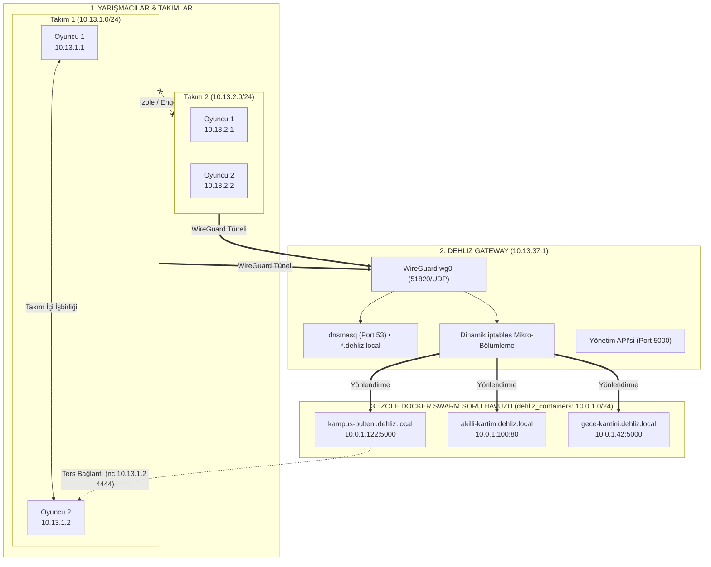

# 🛡️ Dehliz CTF — Yeni Nesil Siber Tatbikat Sahası (Cyber Range)

[](https://www.wireguard.com/)
[](https://ctfd.io/)
[](https://docs.docker.com/engine/swarm/)
[](https://opensource.org/licenses/MIT)

> *"Karanlıkta kalan portlar, aşılamaz surlar ve sadece tünelden sızılabilen bir siber poligon."*

**Dehliz CTF**, CTFd platformunu tek bir komutla Hack The Box / Cyber Range kalitesinde **izole, çok kiracılı (multi-tenant) ve şifreli tünelli bir siber tatbikat sahasına** dönüştüren açık kaynaklı bir altyapı motorudur.

Geleneksel CTF'lerin FRP port karmaşasını (`185.x.x.x:31452`) tarihe gömer; sıfır dış port kuralı, takım içi serbest haberleşme, tam takım izolasyonu ve otomatik yerel DNS (`*.dehliz.local`) sunar.

---

## 🌟 Neden Dehliz CTF? (Geleneksel FRP vs Dehliz)

| Özellik | Geleneksel CTFd + FRP | 🛡️ Dehliz CTF |
| :--- | :--- | :--- |
| **Dış Port Güvenliği** | Her soru için internete rastgele port açılır | **0 Dış Port!** Konteynerler internete tamamen kapalıdır |
| **Bağlantı Türü** | TCP Port Forwarding | **WireGuard Kriptografik Şifreli Tünel** |
| **Ad Çözümleme (DNS)** | Yok (Yalnızca çirkin IP ve portlar) | **Otomatik Yerel DNS:** `http://soru-adi.dehliz.local` |
| **Ters Bağlantı (Reverse Shell)** | İmkansız / Çok Zor (Modem NAT engeli) | **Doğrudan Oyuncunun VPN IP'sine:** `nc 10.13.1.2 4444` |
| **Ağ Taraması (Port Scan)** | Yapılamaz (Yalnızca verilen tek port) | **Tam Nmap Desteği:** `nmap soru-adi.dehliz.local` |
| **Takım İzolasyonu** | Yok (Takımlar birbirine saldırabilir) | **Çekirdek Düzeyinde `iptables` Mikro-Bölümleme (DROP)** |
| **Takım İçi İşbirliği** | Yok | **Serbest:** Takım arkadaşları birbirinin IP'sine erişebilir |
| **Kaynak Tüketimi** | Ağır Java/Go proxy'leri | **Ultra Hafif:** Alpine Linux Gateway (~50 MB RAM!) |

---

## 🏛️ Mimari Şema & Ağ Topolojisi



---

## ⚡ Hızlı Kurulum (Quickstart)

### Gereksinimler:
* Linux (Ubuntu / Debian / CentOS / Arch) veya Windows (Docker Desktop WSL2)
* Docker & Docker Compose v2+

### 1. Depoyu Klonlayın
```bash
git clone https://github.com/your-username/dehliz-ctf.git
cd dehliz-ctf
```

### 2. Tek Komutla Kurulumu Başlatın

**Linux / macOS:**
```bash
chmod +x install.sh
./install.sh
```

**Windows (PowerShell):**
```powershell
Set-ExecutionPolicy Bypass -Scope Process -Force
.\install.ps1
```

Kurulum tamamlandığında:
* **CTFd Web Paneli:** `http://localhost:8000`
* **WireGuard Portu:** `51820/UDP`
* **Yerel DNS:** `10.13.37.1:53` (*.dehliz.local)

---

## ⚙️ Yapılandırma (`.env`)

Sistem ayarlarını özelleştirmek için `.env` dosyasını düzenleyebilirsiniz:

```ini
# Sunucunuzun yarışmacılara açık olan Dış IP adresi veya Domain'i
WG_HOST=192.168.1.100
WG_PORT=51820

# Soru makinelerine atanacak özel alan adı uzantısı
DEHLIZ_DOMAIN=dehliz.local

# CTFd Güvenlik Anahtarı
SECRET_KEY=super_gizli_uretim_anahtari_2026
```

---

## 🚀 Soru Ekleme & Geliştirme

Dehliz CTF için soru hazırlamak çok kolaydır:
1. `examples/sample-challenge` dizinindeki hazır şablonu inceleyin.
2. Konteynerinizi oluşturup build edin:
   ```bash
   docker build -t mychall:latest examples/sample-challenge
   ```
3. CTFd Admin panelinde **Whale** eklentisinden yeni soru oluşturup imaj adı olarak `mychall:latest` belirtin.
4. Soru başladığında yarışmacıya otomatik olarak `http://mychall.dehliz.local` linki atanacaktır!

---

## 📄 Lisans
Bu proje [MIT Lisansı](LICENSE) ile lisanslanmıştır. Eğitim, akademik ve ticari amaçlarla özgürce kullanılabilir ve geliştirilebilir.
